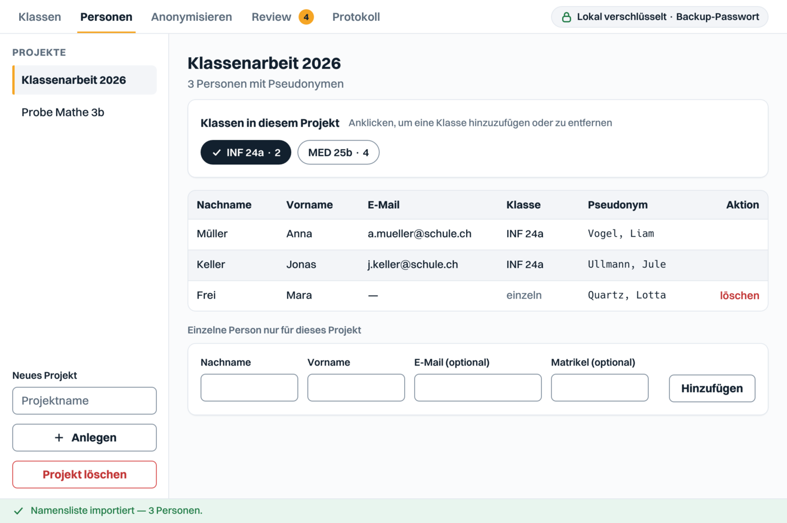
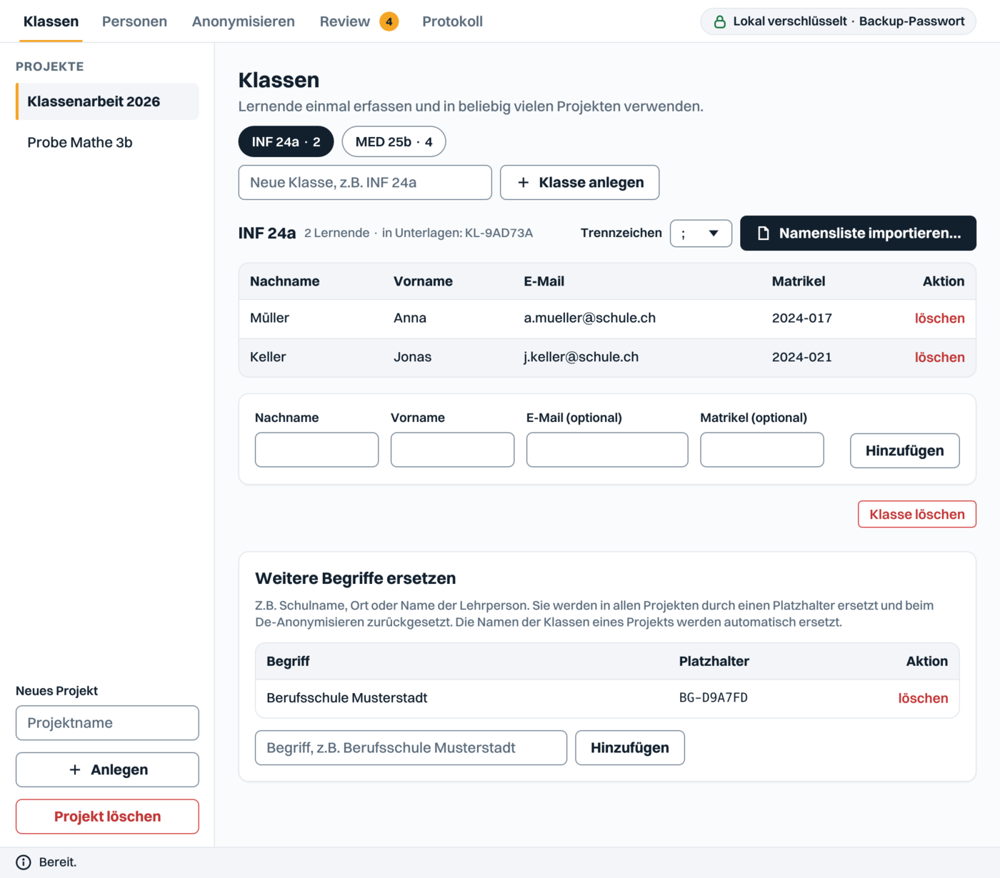
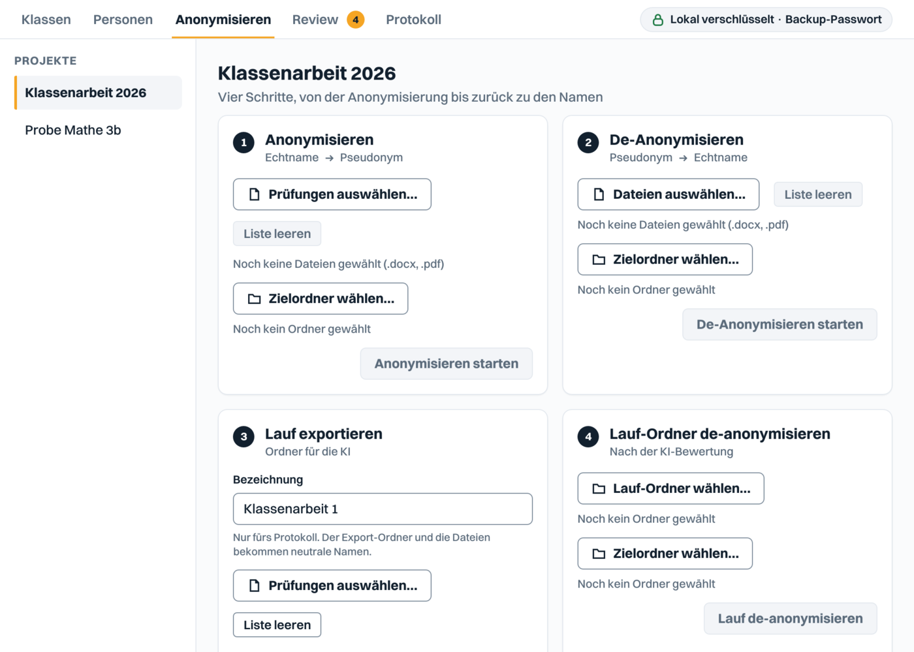
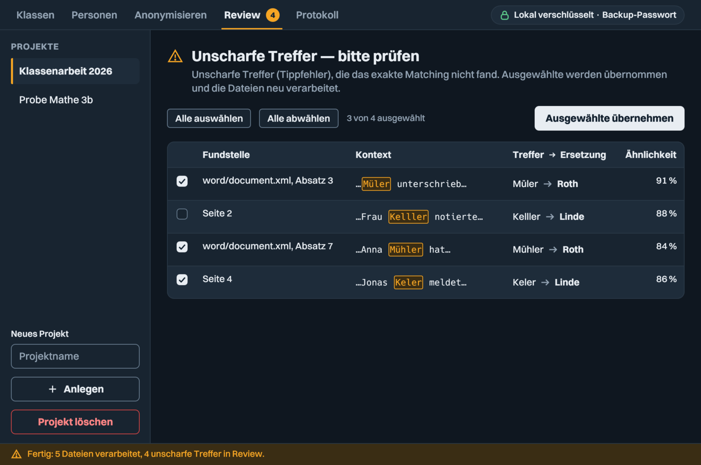

<p align="center">
  
</p>

<p align="center">
  <b>Prüfungen anonymisieren, extern bewerten lassen, Namen zurückholen.</b><br>
  Alle Namen bleiben lokal und verschlüsselt auf deinem Gerät.
</p>

<p align="center">
  <a href="https://github.com/davidMalesevic/nema/releases/latest"><b>Download: Windows · macOS · Linux</b></a>
</p>

---

Nema ist eine Desktop-App für Lehrpersonen. Sie ersetzt in Prüfungen (Word und PDF)
die Namen der Lernenden durch Pseudonyme, damit du die Unterlagen einer KI zur
Bewertung geben kannst, ohne Personendaten herauszugeben. Die bewerteten Unterlagen
holst du danach zurück, und Nema setzt die echten Namen wieder ein.

Die App sendet selbst nichts ins Internet. Was du der KI gibst, entscheidest du.



## Testversion: bitte beachten

Nema ist in einer frühen Testphase. Danke, dass du mithilfst.

- **Arbeite mit Kopien**, nicht mit dem einzigen Original einer Prüfung.
- **Schau den Export an, bevor du ihn weitergibst.** Nema findet Namen in der
  erfassten Schreibweise. Spitznamen, Handschrift und gescannte PDFs (reine Bilder)
  erkennt es nicht.
- **Merk dir das Backup-Passwort.** Ohne Schlüsselbund und ohne Passwort ist der
  Tresor nicht mehr lesbar, und damit die Zuordnung Pseudonym ↔ Name.
- Rückmeldungen gerne als [Issue](https://github.com/davidMalesevic/nema/issues)
  oder direkt an mich: was unklar war, was nicht ersetzt wurde, was abgestürzt ist.

## Installation

Lade die Datei für dein System von der [Release-Seite](https://github.com/davidMalesevic/nema/releases/latest).

| System | Datei | So startest du |
|---|---|---|
| **Windows** 10/11 | `nema-windows-x64.zip` | ZIP entpacken, im Ordner `Nema` die Datei `Nema.exe` starten. `pdfium.dll` muss im selben Ordner bleiben. |
| **macOS** 11+ (Intel und Apple Silicon) | `nema-macos-universal.dmg` | DMG öffnen, Nema in den Ordner «Programme» ziehen, von dort starten. |
| **Linux** x86_64 | `nema-linux-x86_64.AppImage` | Datei ausführbar machen (`chmod +x`) und starten. Braucht GTK 3. |

Die App ist noch nicht signiert, darum warnen Windows und macOS beim ersten Start:

- **Windows:** Im blauen Fenster «Der Computer wurde durch Windows geschützt» auf
  *Weitere Informationen* und dann *Trotzdem ausführen* klicken.
- **macOS:** Den ersten Start blockiert macOS. Öffne danach *Systemeinstellungen →
  Datenschutz & Sicherheit* und klicke bei Nema auf *Dennoch öffnen*. Falls das nicht
  angeboten wird, hilft im Terminal:
  `xattr -dr com.apple.quarantine /Applications/Nema.app`

## Erste Schritte

1. **Tresor anlegen.** Beim ersten Start wählst du, ob der Tresor über den
   Schlüsselbund deines Betriebssystems entsperrt wird, und setzt ein Backup-Passwort.
2. **Klasse erfassen** (Tab *Klassen*). Klasse anlegen, Namensliste importieren
   (CSV oder TXT, z. B. `Nachname;Vorname;E-Mail`) oder Lernende einzeln eintragen.
   Das machst du einmal pro Klasse.
3. **Projekt anlegen** (links unten), z. B. ein Modul oder eine Prüfung. Im Tab
   *Personen* klickst du die Klassen an, die dazugehören.
4. **Anonymisieren** (Tab *Anonymisieren*, Karte 3 «Lauf exportieren»). Prüfungen
   wählen, Zielordner wählen, exportieren. Der Ordner enthält nur noch Pseudonyme.
   Im Tab *Review* prüfst du mögliche Tippfehler-Varianten von Namen.
5. **Bewerten lassen.** Den Export-Ordner gibst du der KI deiner Wahl.
6. **Zurückholen** (Karte 4 «Lauf-Ordner de-anonymisieren»). Ordner mit den
   bewerteten Dateien wählen, Zielordner wählen: die echten Namen stehen wieder drin.

| Klassen verwalten | Anonymisieren |
|---|---|
|  |  |



## Was ersetzt wird

- **Personen:** Vollname, «Nachname, Vorname», Vor- und Nachname einzeln, E-Mail-Adresse
  und Matrikelnummer. Gross- und Kleinschreibung spielt keine Rolle.
- **Nur ganze Wörter:** «Tim» wird nicht in «Optimierung» ersetzt. Ein Genitiv-s
  gehört dazu («Annas Lösung»).
- **Klassennamen** der Klassen eines Projekts (ab 4 Zeichen) und **eigene Begriffe**
  wie Schulname, Ort oder Lehrperson (Tab *Klassen*, unten).
- **Dateinamen:** aus `Müller_Anna.docx` wird z. B. `Lang_Max_anonym.docx`.
  Der Export-Ordner bekommt einen neutralen Namen.
- **Word (DOCX):** Text in Dokument, Kopf- und Fusszeilen, Fussnoten und Kommentaren,
  auch wenn Word einen Namen intern zerstückelt hat. Änderungsverfolgung wird
  übernommen, Autor und weitere Metadaten werden entfernt.
- **PDF:** Der Text wird direkt umgeschrieben, Metadaten werden entfernt. Namen, die
  das PDF auf mehrere Textstücke verteilt, meldet Nema als Warnung.
- **Tippfehler** («Müler») ersetzt Nema nicht von selbst: sie erscheinen im Tab
  *Review* und werden erst nach deiner Bestätigung übernommen.

Jede Person bekommt pro Projekt ein eigenes Pseudonym. Dasselbe Pseudonym gilt in
allen Dateien des Projekts, in einem anderen Projekt heisst die Person anders.

### Grenzen

- Gescannte PDFs und Bilder werden nicht verarbeitet.
- Andere Schreibweisen (Spitznamen, «INF24a» statt «INF 24a», gebeugte Formen wie
  «Müllern») werden nicht exakt erkannt.
- Sehr kurze Klassennamen wie «3b» bleiben stehen, weil sonst auch «Aufgabe 3b»
  verändert würde.

## Sicherheit

- Klassen, Namenslisten und die Zuordnung Name ↔ Pseudonym liegen in einem
  **verschlüsselten Tresor** (AES-256-GCM) im Datenordner der App
  (`%APPDATA%\nema`, `~/Library/Application Support/nema`, `~/.local/share/nema`).
- Der Schlüssel liegt im **Schlüsselbund des Betriebssystems** (Windows Credential
  Manager, macOS Keychain, Linux Secret Service) und zusätzlich, mit deinem
  **Backup-Passwort** geschützt (Argon2id), im Tresor.
- Das **Protokoll** enthält nur Pseudonyme, Dateinamen und Zähler, keine Klarnamen.
- Keine Netzwerkzugriffe, keine Telemetrie.

## Entwicklung

Rust-Workspace mit zwei Crates:

```
core/        nema-core: gesamte Logik, ohne Oberfläche, mit Tests
app/         nema-app: Oberfläche (egui), dünne Schicht über nema-core
packaging/   Logo, Icons, AppImage-Skript, macOS-Bundle-Daten
docs/        Design-Vorgaben (Tokens, Brief) und Screenshots
```

```sh
cargo run -p nema-app                     # starten
cargo test --workspace                    # Tests
cargo clippy --workspace --all-targets    # Lints
cargo build --release -p nema-app         # Release-Build

# Alle Screens als PNG rendern (hell und dunkel), nach target/shots/
cargo test -p nema-app shots -- --ignored
```

Unter Linux braucht der Build die Entwicklungspakete von GTK 3 und D-Bus
(Debian/Ubuntu: `libgtk-3-dev libdbus-1-dev`).

**PDFium:** Die PDF-Verarbeitung braucht Googles PDFium (`pdfium.dll`,
`libpdfium.dylib`, `libpdfium.so`) von
[pdfium-binaries](https://github.com/bblanchon/pdfium-binaries/releases). Die App
sucht sie in der Umgebungsvariable `NEMA_PDFIUM_LIB`, dann neben der ausführbaren
Datei, dann im Systempfad. `nema-app --check-pdfium` prüft, ob sie gefunden wird.
Die PDF-Tests laufen nur, wenn `NEMA_PDFIUM_LIB` gesetzt ist.

**Releases:** Ein Tag `v*` baut über GitHub Actions die Downloads für alle drei
Systeme (`.github/workflows/release.yml`).

## Rechte

© David Malesevic. Alle Rechte vorbehalten; der Code steht (noch) unter keiner
Open-Source-Lizenz.

Schrift: [Switzer](https://www.fontshare.com/fonts/switzer) von Indian Type Foundry
(Fontshare), in die App eingebettet. PDF-Verarbeitung: PDFium (BSD-Lizenz).
